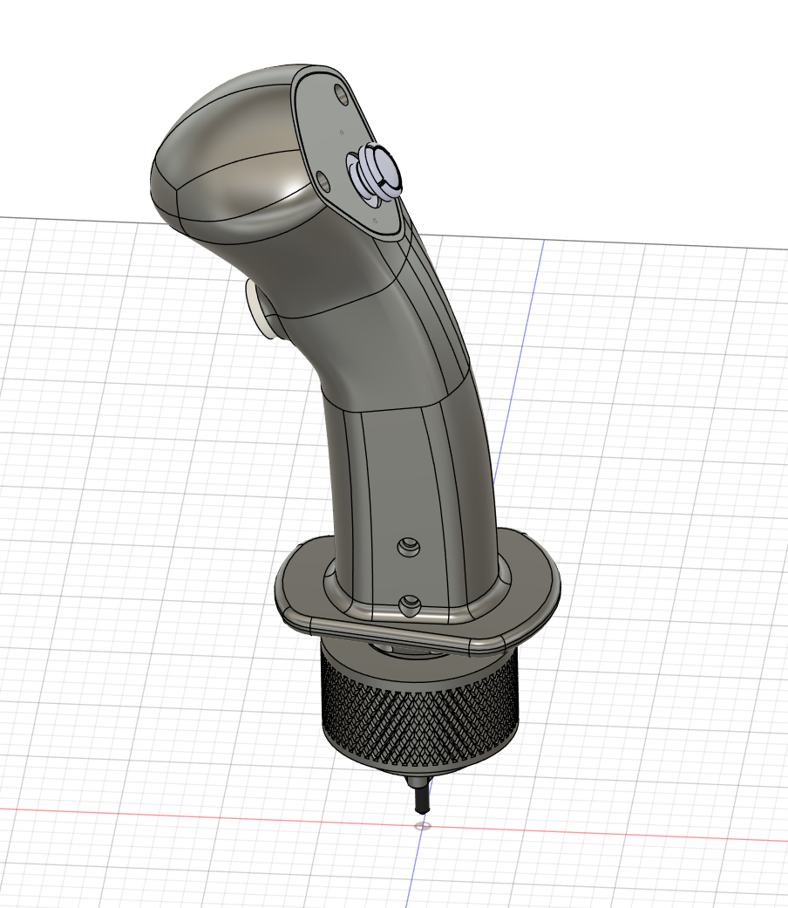

<div align="center">

# Polysim Grip G1

**An open, 3D-printable flight simulator joystick grip with a thumb stick, a side button and an I2C interface.**

[](https://www.printables.com/model/1278269-3d-printable-flight-simulator-joystick-grip)
[](https://www.thingiverse.com/thing:6879827)
[](#-download)

[](LICENSE.md)




</div>

---

## Table of contents

- [Overview](#-overview)
- [Download](#-download)
- [Repository structure](#-repository-structure)
- [Hardware](#-hardware)
- [Firmware](#-firmware)
- [I2C protocol](#-i2c-protocol)
- [Customizing the grip](#-customizing-the-grip)
- [License](#-license)
- [Contributing](#-contributing)

## 🎯 Overview

The **Polysim Grip G1** is a joystick handle for flight simulators, designed in Autodesk Fusion and built to
be 3D printed at home.

- **Ergonomic curved shell** with a flared palm rest.
- **Analog thumb stick** (X/Y axes + push click) on the top plate.
- **Side push button**.
- **Embedded PCB** with an Arduino-compatible microcontroller that digitizes every input.
- **I2C slave interface** (address `0x55`): the joystick base reads the grip over SDA/SCL.
- **Knurled locking ring** that screws the grip onto the base.

This repository holds the **source files**: the complete CAD assembly (STEP), the grip firmware and its
documentation. Printable files and print settings are on the model pages listed below.

## 📥 Download

| Platform | Status | Link |
|---|---|---|
| **Printables** | ✅ Available | [3D printable flight simulator joystick grip](https://www.printables.com/model/1278269-3d-printable-flight-simulator-joystick-grip) |
| **Thingiverse** | ✅ Available | [thing:6879827](https://www.thingiverse.com/thing:6879827) |
| **MakerWorld** | 🕒 Coming soon | — |

The editable CAD source is in [`cad/grip-g1.step`](cad/grip-g1.step).

## 📁 Repository structure

```
Polysim_Grip/
├── cad/
│   └── grip-g1.step            Full CAD assembly (shell, button, thumb stick, PCB) – STEP AP214, mm
├── firmware/
│   └── polysim_grip/
│       └── polysim_grip.ino    Grip firmware (Arduino, I2C slave)
├── docs/
│   ├── hardware.md             Assembly tree, PCB components, wiring
│   ├── i2c-protocol.md         Register map and master-side example
│   └── images/
│       └── grip-g1.png         CAD render
├── CHANGELOG.md
├── LICENSE.md
└── README.md
```

## 🔧 Hardware

The CAD assembly contains three sub-assemblies:

| Part | Description |
|---|---|
| `Grip G1` | Shell, top plate, collar and knurled locking ring |
| `Joystick V2` | Analog thumb stick with push click |
| `Button` | Side momentary push button |
| `PCB_GRIP_V2` | Grip electronics: microcontroller, power, connectors, status LED |

### Wiring (from the firmware)

| Input / output | MCU pin | Notes |
|---|---|---|
| Side button | `A0` | Internal pull-up, active low |
| Thumb stick click | `A1` | Internal pull-up, active low |
| Thumb stick X axis | `A2` | Analog, 10-bit |
| Thumb stick Y axis | `A3` | Analog, 10-bit |
| Status LED | `D2` | On when the firmware is running |
| I2C SDA / SCL | `A4` / `A5` | To the joystick base |

See [docs/hardware.md](docs/hardware.md) for the full component list.

## 💾 Firmware

The firmware targets an **ATmega328P**-based board (Arduino Nano, Pro Mini, Uno, or the MCU on the grip PCB).
It only uses the standard `Wire` library.

**Arduino IDE:** open `firmware/polysim_grip/polysim_grip.ino`, select your board, then click *Upload*.

**arduino-cli:**

```bash
arduino-cli compile --fqbn arduino:avr:nano firmware/polysim_grip
arduino-cli upload  --fqbn arduino:avr:nano -p <PORT> firmware/polysim_grip
```

When powered, the status LED turns on and the grip answers on I2C address `0x55`.

## 🔌 I2C protocol

The joystick base (I2C master) writes a register number, then reads the value:

| Register | Value | Size | Format |
|---|---|---|---|
| `0x01` | Side button | 1 byte | `≈0xFF` released, `≈0x00` pressed |
| `0x02` | Thumb stick click | 1 byte | `≈0xFF` released, `≈0x00` pressed |
| `0x03` | X axis | 2 bytes | Big-endian, `0`–`1023` |
| `0x04` | Y axis | 2 bytes | Big-endian, `0`–`1023` |

The full specification and a master-side Arduino example are in [docs/i2c-protocol.md](docs/i2c-protocol.md).

## ✏️ Customizing the grip

1. Open `cad/grip-g1.step` in Fusion, FreeCAD, SolidWorks, Onshape, or any CAD tool that reads STEP.
2. Edit the shell to fit your hand, or add button holes.
3. Export each part as STL/3MF and slice it.

The PCB and the thumb stick are part of the assembly, so you can check clearances before printing.

## 📄 License

Released under the [Sustainable Use License 1.0](LICENSE.md):

- ✅ Personal, non-commercial and internal use, modification and free redistribution.
- ❌ Commercial use (for example selling printed grips or kits) is not permitted.

Redistributed copies must include the license, and modified copies must say they were modified.

## 🤝 Contributing

Issues and pull requests are welcome: bug reports, firmware improvements, printing feedback or remixes.
If you print the grip, please share a make on Printables or Thingiverse.
