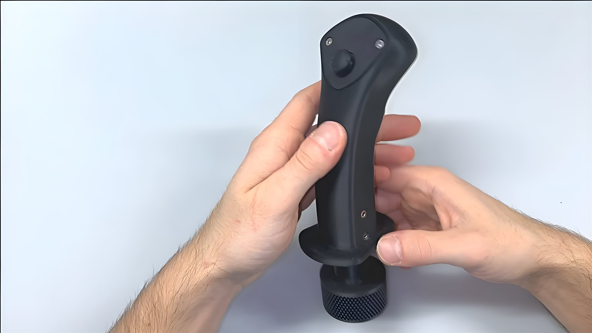
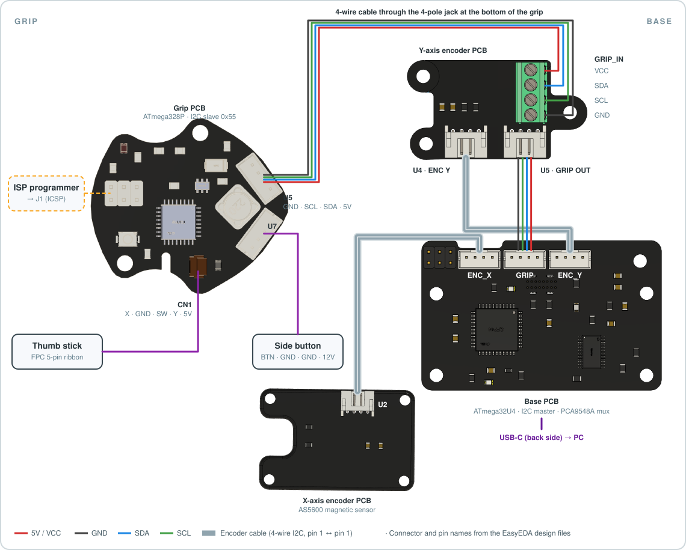

# Polysim Grip G1

**An open, 3D-printable flight simulator joystick grip with a thumb stick, a side button and an I2C interface.**

---

## 🎯 Overview

A 3D-printable joystick grip with a thumb stick and a side button. It talks to the joystick base over I2C.

## 📥 Download

| Files | Folder | Printables | Thingiverse | MakerWorld |
|---|---|---|---|---|
| **STL** – one per part | [`cad/stl`](cad/stl) | [Download](https://www.printables.com/model/1278269-3d-printable-flight-simulator-joystick-grip) | [Download](https://www.thingiverse.com/thing:6879827) | 🕒 Coming soon |
| **3MF** – print plates | [`cad/3mf`](cad/3mf) | — | — | 🕒 Coming soon |
| **STEP** – full assembly with PCB | [`cad/step`](cad/step) | — | — | — |

## 🛒 Get the kit

Get the **[Polysim Grip – 3D printable kit](https://polysim.fr/products/polysim-grip-3d-printable-kit)**
(main button + thumb stick), print the parts, then follow the
**[assembly tutorial on YouTube](https://www.youtube.com/watch?v=2aSrMxbHL8U)**.

## 🔌 How it connects

  

More details are in [docs/hardware.md](docs/hardware.md).

## 💾 Firmware

The grip PCB has no USB port: flash it through its **ICSP header (J1)** with a USBasp or an *Arduino as ISP*.

1. In the Arduino IDE, open `firmware/polysim_grip/polysim_grip.ino`.
2. Select **Tools → Board → Arduino Nano**, then **Tools → Programmer → USBasp** (or *Arduino as ISP*).
3. Connect the programmer to J1, then click **Sketch → Upload Using Programmer**.

> ⚠️ Don't use *Burn Bootloader*: it can make the grip PCB stop responding.

## 📡 I2C protocol

See [docs/i2c-protocol.md](docs/i2c-protocol.md).

## 📄 License

Released under the [Sustainable Use License 1.0](LICENSE.md):

- ✅ Personal, non-commercial and internal use, modification and free redistribution.
- ❌ Commercial use (for example selling printed grips or kits) is not permitted.

Redistributed copies must include the license, and modified copies must say they were modified.
