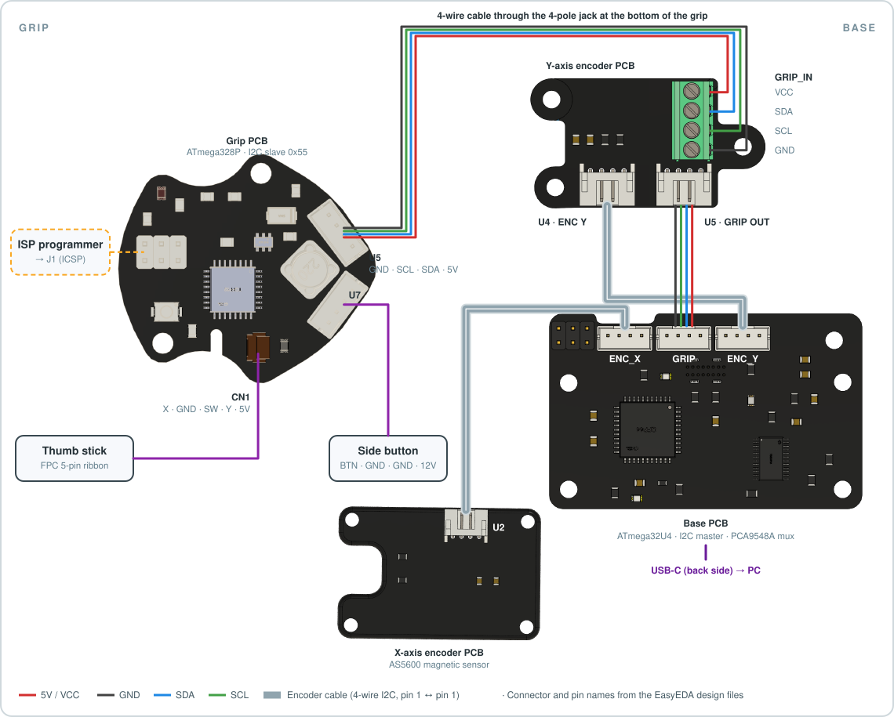

# Hardware

The easiest way to build the grip is the
**[Polysim Grip – 3D printable kit](https://polysim.fr/products/polysim-grip-3d-printable-kit)**.

## How it connects

  

- The **thumb stick** and the **side button** are wired to the **grip PCB** in the grip head.
- The PCB's **ATmega328P** reads them and sends their state to the **joystick base** over a
  **4-wire cable** (VCC, GND, SDA, SCL). The cable goes through the bottom connector.
- The **ICSP header (J1)** is only used to upload the firmware (see the [README](../README.md#-firmware)).

## Parts to print

All STL files are in [`../cad/stl/`](../cad/stl). The full assembly, with the PCB, is in
[`../cad/step/grip-g1.step`](../cad/step/grip-g1.step).
